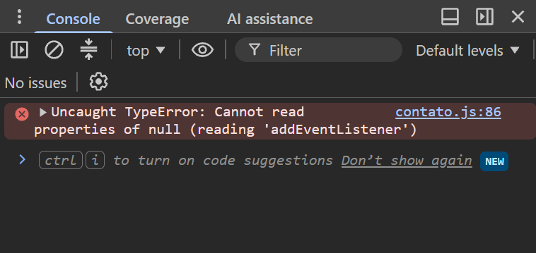
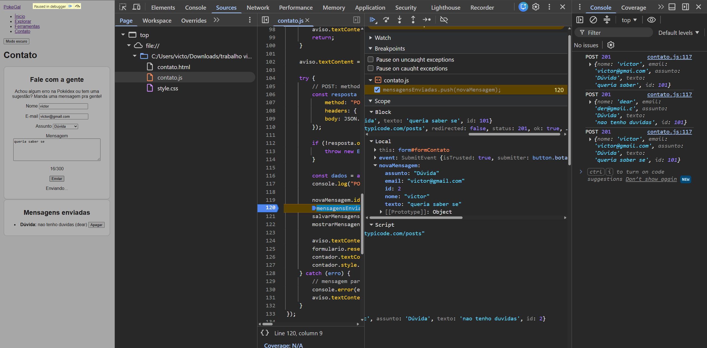
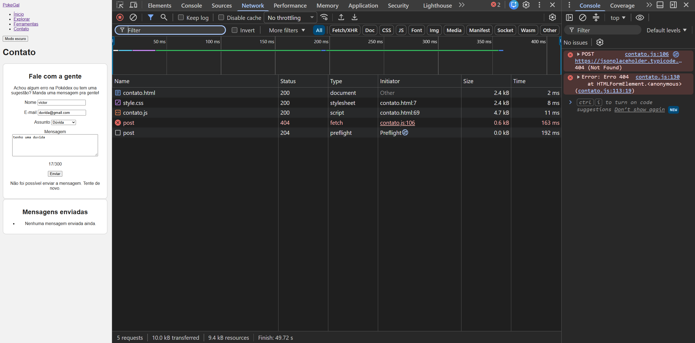

# PokeGal - Pokédex

Projeto final (RA 3) da matéria de Web Development: Front-End, na PUCPR.

O tema é uma Pokédex. O site puxa os dados reais dos Pokémon de uma API pública, mostra tudo em cartões com busca, filtro por tipo e favoritos, tem uma página de ferramentas e um formulário de contato.

Site publicado: (colocar o link do GitHub Pages aqui)

## Integrantes

- **Guilherme:** fez a base do site e a parte de ferramentas.
- **João:** fez o CSS e o modo escuro.
- **Victor:** fez a página de contato (formulário e envio das mensagens) e o relatório de debugging do TDE 02.

## Páginas

- `index.html`: início, com a apresentação do projeto e do grupo
- `explorar.html`: os Pokémon em cartões, com busca, filtro, favoritos e a tela da Pokédex
- `ferramentas.html`: as ferramentas do TDE 01
- `contato.html`: formulário de contato que envia a mensagem com POST

O `style.css` é o mesmo para todas as páginas, e o `script.js` cuida do modo escuro em todas elas. Cada página tem também o seu próprio `.js`.

## API

Usamos a **PokéAPI** (https://pokeapi.co), que é gratuita, não precisa de chave e libera CORS.

- `GET https://pokeapi.co/api/v2/pokemon?limit=151` traz a lista dos 151 primeiros Pokémon (só nome e url).
- `GET https://pokeapi.co/api/v2/pokemon/{id}/` traz os detalhes de cada um: imagem, tipos, altura, peso e status.

Para o formulário de contato usamos o **JSONPlaceholder**:

- `POST https://jsonplaceholder.typicode.com/posts` recebe a mensagem e devolve o status 201. Ele não salva de verdade, então o histórico de mensagens fica no localStorage.

## localStorage

- `favoritosPokedex`: os Pokémon marcados como favoritos
- `tema`: se o modo escuro está ligado ou não
- `mensagensContato`: as mensagens enviadas pelo formulário

## TDE 01 - Funções em JavaScript


## TDE 02 - Debugging em JavaScript

Erros que apareceram na página de contato (`contato.js`). Os números de linha são de quando o erro aconteceu (dá pra ver nos prints). Depois disso o `contato.js` foi simplificado, então hoje as linhas mudaram de lugar.

### Erro 1: o formulário não enviava (TypeError)

- **Sintoma:** ao clicar em Enviar a página só recarregava. No console: `Uncaught TypeError: Cannot read properties of null (reading 'addEventListener')`, na linha 86.
- **Como achamos:** o console apontou a linha 86. Um `console.log(formulario)` mostrou `null`: o id no HTML é `formContato` e no JS estava `formcontato`, tudo minúsculo.
- **Solução:** arrumamos o id no JS.

```js
// antes
const formulario = document.getElementById("formcontato");
// depois
const formulario = document.getElementById("formContato");
```



### Erro 2: apagar uma mensagem apagava duas (erro de lógica)

- **Sintoma:** sem erro no console, mas depois de apagar uma mensagem e mandar outra, o botão Apagar tirava duas de uma vez.
- **Como achamos:** breakpoint na linha 120. No Scope, a `novaMensagem` e a mensagem já salva estavam com o mesmo `id: 2`. O `gerarId` usava o tamanho do array, então o id repetia depois de apagar uma mensagem.
- **Solução:** o id agora é o da última mensagem + 1.

```js
// antes
return mensagensEnviadas.length + 1;
// depois
return mensagensEnviadas[mensagensEnviadas.length - 1].id + 1;
```



### Erro 3: o POST dava 404 (aba Network)

- **Sintoma:** aparecia "Não foi possível enviar a mensagem. Tente de novo." No console: `POST https://jsonplaceholder.typicode.com/post 404 (Not Found)`.
- **Como achamos:** na aba Network a requisição `post` estava em vermelho, com status 404. A URL terminava em `/post`, faltando o "s".
- **Solução:** corrigimos a URL na constante `API_CONTATO`.

```js
// antes
const API_CONTATO = "https://jsonplaceholder.typicode.com/post";
// depois
const API_CONTATO = "https://jsonplaceholder.typicode.com/posts";
```


